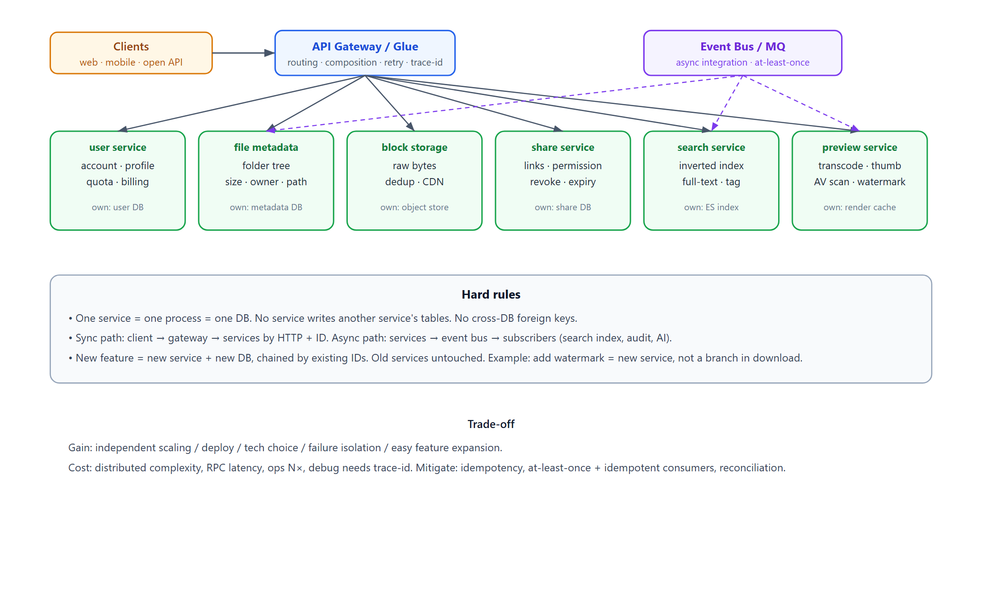
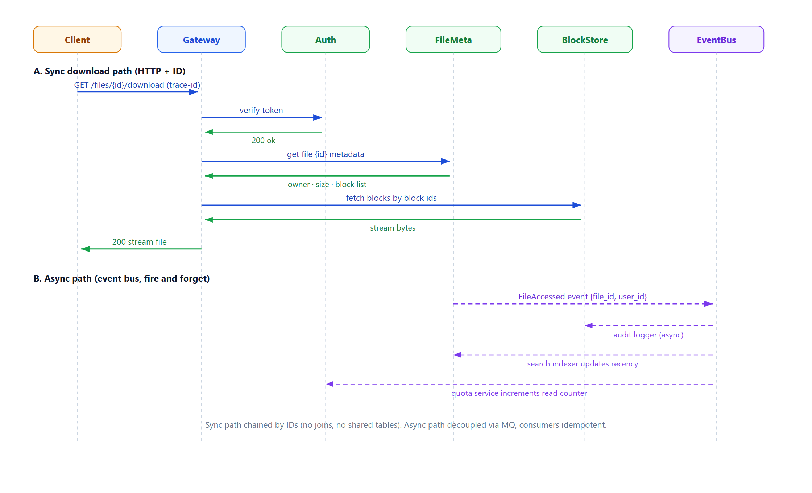

# Learn Microservices — One DB Per Service, Bound by Unique ID

> **Learning / study repo. Self-contained demo / simulation, NOT production code.**
> It exists to learn the core microservice data rule: **each service owns exactly one
> database, databases never share tables or foreign keys, services are chained only by
> unique business IDs** (user_id, product_id, order_id).

## Cloud-drive architecture in one picture



```
  Clients ─► API Gateway / Glue ─► user · file-metadata · block-storage · share · search · preview
                                   each service owns its own DB, chained by ID
                                   services ──(async events)──► Event Bus ─► audit / search-index / quota
```

## Why cloud drives are built this way

A cloud drive is not one system — it is capabilities with totally different rhythms:
account/login (strong, low-frequency), file metadata (extreme read concurrency), block
storage (massive small IO), search (inverted index), preview (CPU-heavy transcode),
share (revocable links), quota/billing (reconciliation). Different concurrency models,
data volumes, tech stacks, release cadences. Squeezing them into one DB means file
listing drags down login, and changing share logic regresses everything.

**One service one DB buys:** independent scaling, independent tech choice, failure
isolation, clean data boundary (no `join files inside users`).

**Why chain by ID, not shared tables / foreign keys:** shared DB = coupled releases;
foreign keys don't exist across services. An ID is the cheapest contract — order stores
`user_id`, calls user service over HTTP when it needs user info, or subscribes to events
and keeps a read-only copy. **Adding a feature never changes the old DB schema.**

## What "glue" buys you

Don't build one big system. Build tiny single-responsibility components that don't know
each other, and an orchestration layer sticks them into complex behaviors.

- **Components are trivial** — file service just serves bytes by `file_id`; it doesn't
  know about watermarks, AV scan, or AI summaries.
- **Business changes concentrate in the glue** — "download must run virus scan first"
  changes the flow, not the parts.
- **Replaceable / pluggable** — swap object storage, swap transcode engine, as long as
  the ID contract holds. Strangler-fig migration of old systems.
- **Combinatorial reuse** — the same "get file" component is reused by download, preview,
  search indexing, AV scan, AI summary, share links.
- **Fault tolerance in one place** — glue retries / degrades / caches; components stay simple.

## Download flow (sequence)



- **Sync path** (HTTP + ID): client → gateway → auth → file-metadata → block-storage →
  stream bytes back. No joins, no shared tables; every hop carries a trace-id.
- **Async path** (event bus): file-metadata emits `FileAccessed`; audit logger, search
  indexer, quota service subscribe independently. Consumers must be idempotent.

## Downsides and how to avoid them

| Downside | Avoid |
|---|---|
| No cross-service local txn; lost/duplicate events | Idempotency keys; at-least-once + idempotent consumers; eventual consistency + compensation |
| Glue grows into a distributed monolith | Explicit state machine / workflow; glue only decides call order & failure; merge services when flows outgrow N steps |
| Debugging across 6 services is a black box | Mandatory trace-id; central logs/metrics; every service exposes /health |
| Redundant copies drift out of sync | Copies are read-only caches; source of truth stays original service; offline reconciliation |
| RPC latency kills P99 | Parallel calls, batch endpoints, pre-aggregated read models, local cache |
| N× ops cost | Containerize with one template; merge tiny services; shared CI/CD platform |
| Interface changes break all consumers | Backward-compatible additions, versioned breaks, contract tests |
| Glue layer is a single point | Stateless + replicated; edge degradation |
| Premature decomposition | Start monolith; split only when real pain hits (coupled releases, independent scaling need) |

**Three rules to survive:** idempotency everywhere, trace-id end to end, don't split until it hurts.

---

## This demo

Four independent processes, each owning one JSON DB, chained by ID:

| Service | Port | Owns | References (ID only) |
|---|---|---|---|
| user | 7001 | users (name, balance) | — |
| product | 7002 | products (name, price, stock) | — |
| order | 7003 | orders (qty, amount, status) | `user_id`, `product_id` |
| payment | 7004 | payments (amount, status) | `order_id`, `user_id` |

### Run

```bash
python run_all.py
```

Pure Python standard library. It spawns the 4 processes, seeds one user + product, runs
the demo cases, then shuts down.

### Demo cases

1. **Normal order** — create order → deduct balance → deduct stock → record payment →
   mark PAID; detail assembled by calling user + product services by ID.
2. **Insufficient balance** — fails at balance step; stock untouched.
3. **Out of stock** — balance deducted, stock fails; gateway refunds balance as compensation.
4. **Order join by ID** — raw order row has only IDs; detail joins across services on the fly.

## Relation to `learn_distributed_txn`

This repo covers the **data boundary** side (one DB per service, chained by ID). The
sibling repo `learn_distributed_txn` covers the **consistency** side (pre-freeze + state
machine + two-layer self-healing) that production microservices need once failures happen.
