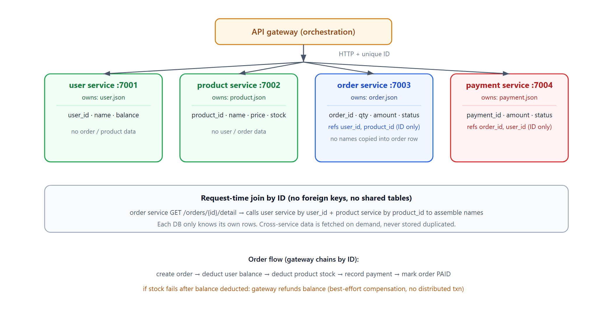

# Learn Microservices — One DB Per Service, Bound by Unique ID

> **Learning / study repo. This is a self-contained demo / simulation, NOT production code.**
> It exists only to learn the core microservice data rule: **each service owns exactly one
> database, databases never share tables or foreign keys, and services are chained together
> only by unique business IDs** (user_id, product_id, order_id).

## The idea



```
  gateway (orchestration)
      │  HTTP + ID
      ├─► user service    →  user.json     (only users)
      ├─► product service  →  product.json  (only products)
      ├─► order service    →  order.json    (only orders; stores user_id, product_id)
      └─► payment service  →  payment.json  (only payments; stores order_id)
```

- One service = one process = one database. No service writes another service's tables.
- Cross-service "joins" are done at request time: order service calls user service by
  `user_id` and product service by `product_id` to assemble a human-readable detail.
- No distributed transaction coordinator. The gateway chains calls; on failure it does a
  best-effort local compensation (e.g. refund balance when stock is unavailable).

## Services

| Service | Port | DB file | Owns | References (ID only, no copies) |
|---|---|---|---|---|
| user | 7001 | `user.json` | users (name, balance) | — |
| product | 7002 | `product.json` | products (name, price, stock) | — |
| order | 7003 | `order.json` | orders (qty, amount, status) | `user_id`, `product_id` |
| payment | 7004 | `payment.json` | payments (amount, status) | `order_id`, `user_id` |

## Run

```bash
python run_all.py
```

Pure Python standard library, no dependencies. It spawns the 4 processes, seeds one user
and one product, runs the demo cases, then shuts everything down.

## Demo cases

1. **Normal order** — gateway creates order, deducts balance, deducts stock, records payment,
   marks order PAID. Order detail is assembled by calling user + product services by ID.
2. **Insufficient balance** — order fails at the balance step; stock is never touched.
3. **Out of stock** — balance was deducted, then stock failed; gateway refunds the balance
   as compensation.
4. **Order join by ID** — raw order row contains only IDs (no names); the detail endpoint
   joins across services by ID on the fly.

## What this demonstrates (and what it doesn't)

**Demonstrates:**
- Database-per-service as a hard boundary.
- Services chained by unique IDs, not by shared tables.
- Request-time "joins" via HTTP calls.
- Best-effort compensation when a downstream step fails.

**Does NOT solve (that's the sibling project `learn_distributed_txn`):**
- Strong cross-service consistency / distributed transactions.
- Idempotency keys, retries, dead-letter queues, node self-healing.
- This demo intentionally keeps the happy path and one compensation branch; production
  microservices need the whole saga/state-machine machinery from the other repo.
